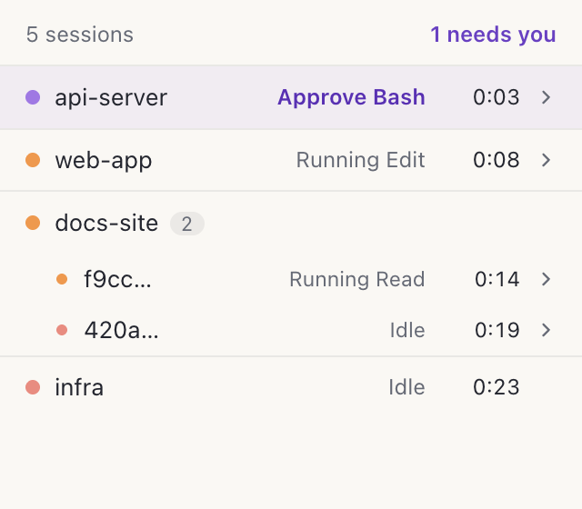

<p align="center">
  
</p>

<h1 align="center">Watchling</h1>

<p align="center"><b>A quiet desktop pet that watches your Claude Code sessions.</b></p>

<p align="center">
  <a href="https://github.com/sht02048/watchling/releases/latest"></a>
  
  <a href="LICENSE"></a>
</p>

<p align="center">
  
</p>

Start a long task, switch to something else, and look up when Peep turns purple. Click the waiting session in the list to jump straight back to its terminal. Peep busies itself while Claude works, carries little companions when background agents run, and pops a speech bubble when a session is waiting for your approval or answer. Watchling only watches: it never answers prompts or approves tools for you.

## Features

- **Live session state** — Peep shows the most urgent state across all your Claude Code sessions
- **Attention bubble** — a purple speech bubble when a session needs approval or an answer, with no sounds or notifications
- **Background companions** — up to three small companions ride on Peep's head while background agents run
- **Session list** — click Peep to see every session grouped by project, with what it's doing and for how long
- **Jump to a session** — click a session to bring its terminal forward; in Orca it opens the exact tab
- **Stays out of the way** — Peep dozes off when nothing is happening, dims, and steps away when no session is open; its size and behavior live in Settings
- **Auto-connect** — hooks install on first launch and can be turned off from the menu bar
- **Local and read-only** — nothing leaves your Mac, and Watchling never changes a session

## Install

Download the latest `.dmg` from [Releases](https://github.com/sht02048/watchling/releases/latest), move Watchling to Applications and launch it. On first launch it connects to Claude Code, shows a one-time notification, and sets itself to open when your Mac starts. You can turn that off under **Settings**.

Requires macOS 13 or later on Apple silicon.

> [!NOTE]
> Builds are not notarized yet. If macOS blocks the first launch, right-click Watchling and choose **Open**.

## Usage

### Peep's states

<p align="center">
  
</p>

| Peep looks              | Meaning                                          |
| ----------------------- | ------------------------------------------------ |
| Purple, speech bubble   | A session is waiting for your approval or answer |
| Grey                    | Watchling missed some signals and can't tell     |
| Orange                  | Claude is working                                |
| Blue, companions on top | Only background agents are running               |
| Coral, then dozes off   | Nothing to do                                    |

With several sessions open, Peep shows the one highest in this table. See [docs/state-model.md](docs/state-model.md) for the full rules.

### Session list

<p align="center">
  
</p>

Click Peep to open the list, and click again or press <kbd>Esc</kbd> to close it. Sessions are grouped by project. Each line shows what the session is doing and how long it has been in that state. Right-click a line for a menu that also copies its session ID, or press <kbd>⌘C</kbd> on it.

### Jump to a session

When Peep turns purple, open the list and click the waiting session. Watchling brings the app that runs it to the front, so you can answer without hunting through windows. Lines you can jump from end in ›, and <kbd>↑</kbd> <kbd>↓</kbd> then <kbd>Return</kbd> work too.

| Where the session runs                               | What a click does             |
| ---------------------------------------------------- | ----------------------------- |
| Orca                                                 | Switches to the session's tab |
| Terminal, iTerm, Ghostty, VS Code, Cursor and others | Brings the app to the front   |
| SSH or no GUI app                                    | Nothing; the line has no ›    |

Watchling only changes which window is in front. It never types into a terminal.

### Menu bar

Watchling has no Dock icon. Use the menu bar icon to show or hide Peep, bring it back to the bottom-right corner with **Reset Position**, turn the Claude Code connection on or off, and quit. Right-click Peep for the same menu. Drag Peep anywhere on screen; it remembers where you left it.

**Settings** in the same menu holds:

- **Open When Mac Starts** — on by default
- **Show on All Spaces** — on by default, including full-screen apps
- **Pet Size** — Small, Medium, Large or Extra Large
- **Hide When No Sessions** — on by default. Peep steps away three minutes after the last session ends and returns as soon as one starts.
- **Dim When Idle** — on by default. Peep fades once every session has been idle for three and a half minutes, half a minute after it dozes off. It brightens when a session starts working or needs you, or when you hover it.

Peep stays fully visible while Watchling can't tell what a session is doing.

## How it works

```
Claude Code ──hook──▶ watchling-hook-emitter ──local socket──▶ Watchling ──▶ Peep
```

Watchling adds hooks to `~/.claude/settings.json`. For each event, Claude Code runs a small Swift helper that forwards a few fields to the app over a local Unix socket. Each hook has a one-second timeout and never replies to Claude Code. While the app isn't running, the helper keeps the same fields in `~/Library/Application Support/watchling/pending`, and Watchling picks them up when it starts.

## Privacy

The helper sends event metadata such as session and tool IDs, the event type, tool names, permission mode, the project folder name, and which app runs the session (its bundle ID and, in Orca, the terminal tab handle). While the app is closed, that metadata waits on disk until the next launch. Prompts, tool input and transcripts are never stored, shown or sent. Tool input is reduced to a one-way fingerprint inside the helper so permission requests can be matched to their tool calls. Watchling makes no network requests.

## FAQ

**Peep doesn't react to my sessions.**
Make sure Watchling runs from Applications and **Connected to Claude Code** is ticked in the menu bar menu. Sessions that ran while Watchling was closed appear when it starts, if their Claude Code process is still running. Sessions from before Watchling was installed appear after their next prompt or tool call, and background agents started before Watchling restarted reappear with their next tool call.

**Where did Peep go?**
With **Hide When No Sessions** on, Peep steps away three minutes after your last session ends and comes back when a new one starts. To bring it back sooner, choose **Show pet** in the menu bar menu or open Watchling again. Turn the setting off under **Settings** to keep Peep on screen.

**Will it slow down Claude Code?**
No. Each hook has a one-second timeout and returns nothing.

**Can I approve permission requests from Peep?**
No, by design. Watchling only tells you that a session needs you; you answer in the terminal.

**What exactly does it change in my settings?**
It adds only its own hook handlers and keeps the rest of `~/.claude/settings.json`. The previous file is backed up to `~/Library/Application Support/watchling/hook-backups`.

## Uninstall

Choose **Uninstall Watchling…** in the menu bar menu. Watchling removes its hooks from `~/.claude/settings.json`, stops opening when your Mac starts, moves itself to the Trash and quits. Optionally delete `~/Library/Application Support/watchling` afterwards.

If you trash the app first, Claude Code keeps working; the leftover hooks check for the helper and do nothing. Installing Watchling again picks them up, even if you deleted its data folder.

## Build from source

<details>
<summary>Only needed for contributing or testing unreleased changes.</summary>
<br>

Requires macOS 13+ on Apple silicon, Node.js 24, pnpm 10 and the Xcode command line tools.

```sh
git clone https://github.com/sht02048/watchling.git
cd watchling
pnpm install
pnpm dev
```

`pnpm make` packages the app and DMG into `build/release/`. Tests, scripts and project layout are described in [CLAUDE.md](CLAUDE.md).

</details>

## Contributing

Issues and pull requests are welcome. Run `pnpm typecheck`, `pnpm test:unit` and `pnpm test:integration` before opening a pull request, and keep the privacy rule: no prompts, tool input or transcripts may be stored, logged, shown or sent.

## License

[MIT](LICENSE). Watchling is an independent project and is not affiliated with Anthropic.
